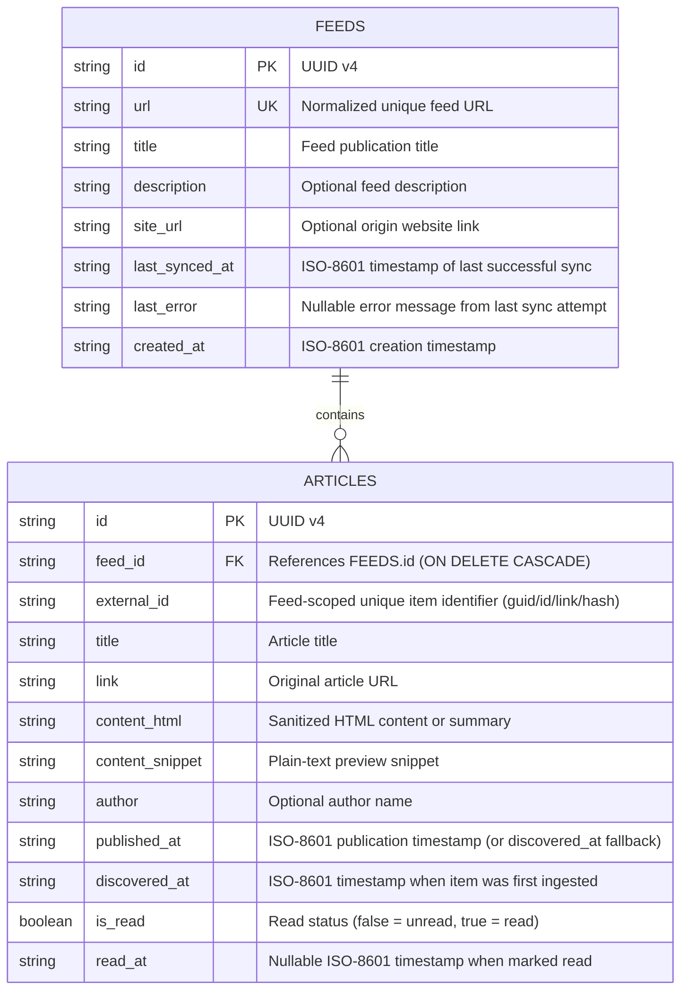
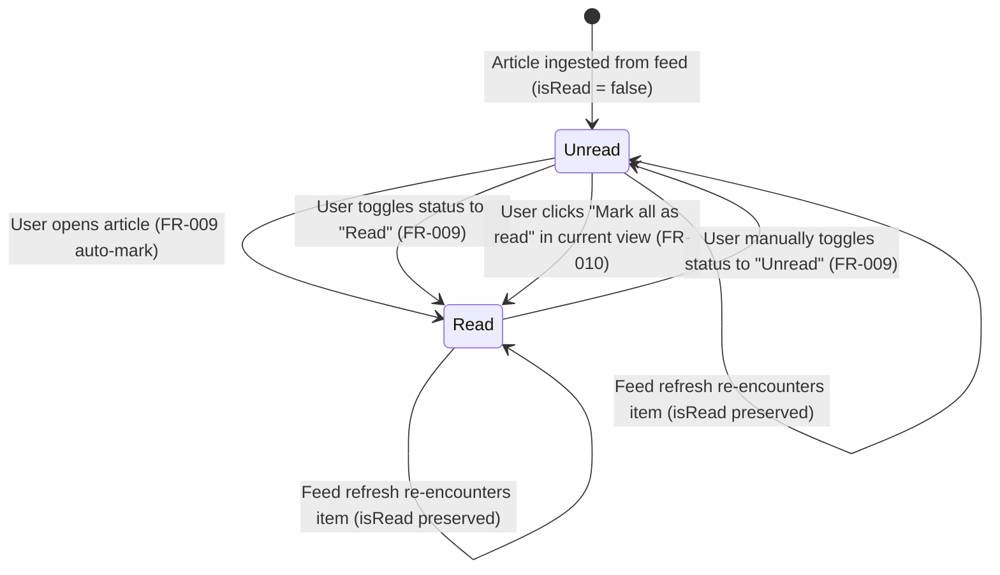

# Phase 1 Data Model: RSS Feed Reader Local

**Feature**: `001-rss-feed-reader`  
**Date**: 2026-11-05  
**Storage Engine**: Local SQLite (`better-sqlite3` + `drizzle-orm`)

## Entity Relationship Diagram

---

## Entities & Fields

### 1. `feeds` (Inscrição de Feed)

Represents an RSS 2.0 or Atom 1.0 feed subscription stored on the local device.

| Field | Type (SQLite / TS) | Constraints | Description |
|-------|--------------------|-------------|-------------|
| `id` | `TEXT` / `string` | `PRIMARY KEY`, `NOT NULL` | UUID v4 generated upon subscription |
| `url` | `TEXT` / `string` | `UNIQUE`, `NOT NULL` | Normalized HTTP/HTTPS URL of the RSS/Atom feed (FR-001, FR-003) |
| `title` | `TEXT` / `string` | `NOT NULL` | Feed title extracted from XML `<title>` (falls back to hostname if blank) |
| `description` | `TEXT` / `string \| null` | `NULL` | Feed subtitle or description |
| `siteUrl` (`site_url`) | `TEXT` / `string \| null` | `NULL` | Link to the publisher's website (`<link>`) |
| `lastSyncedAt` (`last_synced_at`) | `TEXT` / `string \| null` | `NULL` | ISO-8601 UTC timestamp of the last successful fetch |
| `lastError` (`last_error`) | `TEXT` / `string \| null` | `NULL` | Non-blocking error message if the most recent refresh failed (Edge Case) |
| `createdAt` (`created_at`) | `TEXT` / `string` | `NOT NULL` | ISO-8601 UTC timestamp when subscription was created |

**Indexes**:
- `feeds_url_unique_idx` on `(url)` — enforces FR-003 (no duplicate feed URLs).

---

### 2. `articles` (Artigo / Feed Item)

Represents an individual article fetched from a subscribed feed.

| Field | Type (SQLite / TS) | Constraints | Description |
|-------|--------------------|-------------|-------------|
| `id` | `TEXT` / `string` | `PRIMARY KEY`, `NOT NULL` | UUID v4 generated upon first ingestion |
| `feedId` (`feed_id`) | `TEXT` / `string` | `NOT NULL`, `FOREIGN KEY -> feeds.id ON DELETE CASCADE` | Owning feed subscription |
| `externalId` (`external_id`) | `TEXT` / `string` | `NOT NULL` | Deterministic item identity within the feed (`guid` -> `id` -> `link` -> SHA-256 of `title + pubDate`) |
| `title` | `TEXT` / `string` | `NOT NULL` | Article headline (defaults to `"Sem título"` if missing) |
| `link` | `TEXT` / `string \| null` | `NULL` | Direct HTTP/HTTPS URL to original article (FR-008) |
| `contentHtml` (`content_html`) | `TEXT` / `string` | `NOT NULL` | Sanitized HTML body/summary via `sanitize-html` (FR-008) |
| `contentSnippet` (`content_snippet`) | `TEXT` / `string` | `NOT NULL` | Plain-text excerpt (up to 300 chars) for list preview |
| `author` | `TEXT` / `string \| null` | `NULL` | Article author/creator (`dc:creator` or `author`) |
| `publishedAt` (`published_at`) | `TEXT` / `string` | `NOT NULL` | ISO-8601 UTC timestamp used for sorting newest-first; falls back to `discoveredAt` if missing in feed XML (FR-005) |
| `discoveredAt` (`discovered_at`) | `TEXT` / `string` | `NOT NULL` | ISO-8601 UTC timestamp when item was first saved locally |
| `isRead` (`is_read`) | `INTEGER (0\|1)` / `boolean` | `NOT NULL`, `DEFAULT 0` | Read/unread tracking status (`false` = unread, `true` = read) (FR-009) |
| `readAt` (`read_at`) | `TEXT` / `string \| null` | `NULL` | ISO-8601 UTC timestamp of when the item was marked as read |

**Indexes**:
- `articles_feed_external_unique_idx` on `(feed_id, external_id)` — prevents duplicate articles on refresh while preserving existing `is_read` status.
- `articles_published_at_idx` on `(published_at DESC, discovered_at DESC)` — guarantees `<200ms` sorting newest-first across 1,000+ articles (SC-002, SC-004).
- `articles_feed_read_published_idx` on `(feed_id, is_read, published_at DESC)` — optimizes filtering by feed and unread status (FR-006).

---

## Validation & Domain Rules

1. **Feed URL Normalization & Validation (FR-001, FR-002, FR-003)**:
   - Input URL is trimmed, validated with Zod as a valid `http://` or `https://` URL, and normalized (trailing slash normalized when path is empty, fragment `#...` stripped).
   - Before saving a new subscription, the server fetches and parses the XML feed to confirm it is a valid RSS 2.0 or Atom 1.0 document.
2. **Chronological Ordering & Missing Date Fallback (FR-005)**:
   - Queries order articles by `published_at DESC, discovered_at DESC, id DESC`.
   - If an incoming feed item lacks a valid `<pubDate>` or `<updated>` date, `published_at` is set equal to `discovered_at`.
3. **Idempotent Feed Sync & Read Status Preservation (FR-011, Edge Cases)**:
   - On feed refresh, upsert logic matches `(feed_id, external_id)`.
   - Existing articles may update mutable metadata (`title`, `content_html`, `content_snippet`, `link`), but **`is_read` and `read_at` are NEVER overwritten** by a sync operation.
4. **Cascade Deletion (FR-004)**:
   - Deleting a feed subscription automatically deletes all its associated articles via `ON DELETE CASCADE`.

---

## Article Read-Status State Transitions

